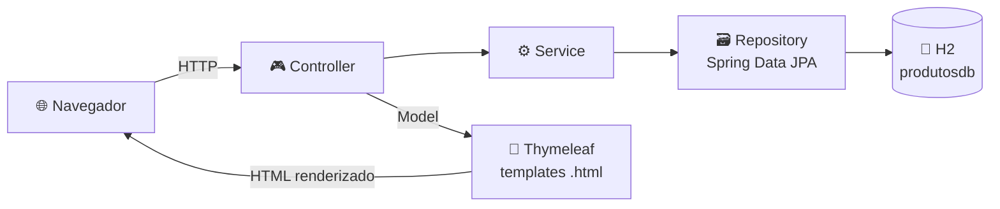
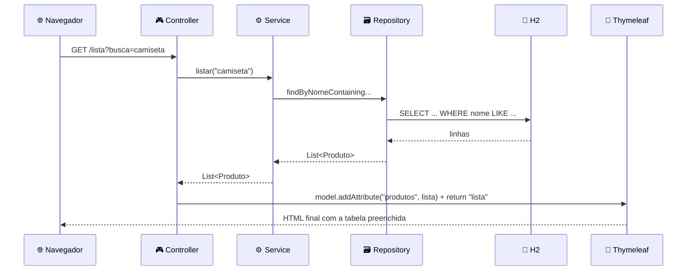
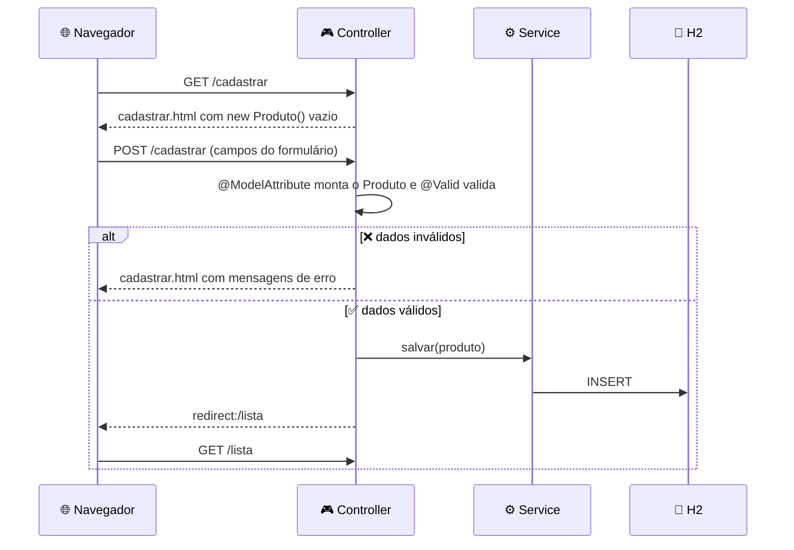

<div align="center">

# 🛒🌿 Cadastro de Produtos

### CRUD web completo em **Spring Boot + Thymeleaf + H2**


📝 **Cadastrar** `/cadastrar` &nbsp;•&nbsp; 📋 **Listar e buscar** `/lista` &nbsp;•&nbsp; 🗑️ **Remover** `/remover/{id}`

*Atividade 08 • Thymeleaf • FATEC Praia Grande • DSM*

</div>

---

## 📌 Sobre o projeto

Aplicação web que permite **cadastrar, listar, buscar e remover produtos**, renderizada no servidor com **Thymeleaf**. O objetivo da atividade é entender o **ciclo completo de uma requisição web**: o usuário preenche um formulário, o servidor recebe e valida os dados, grava no banco e exibe o resultado em outra página.

A versão base do tutorial (formulário com nome, preço e categoria + lista em memória) foi **evoluída com todos os exercícios** propostos no final da atividade.

| | 📝 Cadastro | 📋 Listagem |
|---|---|---|
| **Página** | `cadastrar.html` | `lista.html` |
| **Rota** | `/cadastrar` | `/lista` |
| **Entidade** | `Produto` | `Produto` |
| **Tabela** | `produto` | `produto` |
| **Destaque** | Validação com mensagens de erro | Busca por nome ou categoria |

---

## 🛠️ Tecnologias

| Tecnologia | Uso |
|---|---|
| ☕ **Java 17** | Linguagem |
| 🍃 **Spring Boot 4.1.2** | Framework |
| 🌐 **Spring Web MVC** | Controllers e rotas HTTP |
| 🌿 **Thymeleaf** | Motor de templates HTML |
| 🗄️ **Spring Data JPA / Hibernate** | Persistência |
| 💾 **H2 Database** | Banco relacional em memória |
| ✅ **Bean Validation** | Regras de validação por anotação |
| 🎨 **Bootstrap 4.6** | Estilo das páginas (via CDN) |
| 📦 **Maven** | Gerenciador de dependências |

---

## 🏗️ Arquitetura



| Camada | Classe / Arquivo | Papel |
|---|---|---|
| 🟦 **Model** | `Produto` | Representa os dados do produto |
| 🟩 **View** | `cadastrar.html`, `lista.html` | Interface exibida ao usuário |
| 🟧 **Controller** | `ProdutoController` | Recebe requisições e escolhe a View |
| 🟪 **Service** | `ProdutoService` | Intermedia o Controller e o acesso a dados |
| 🟥 **Repository** | `ProdutoRepository` | Conversa com o banco de dados |

### 📁 Estrutura de pastas

```
src/main/java/br/edu/fatecpg/tecprog/cadastro_produtos/
├── 🚀 CadastroProdutosApplication.java
├── 📦 model/Produto.java
├── 🗃️ repository/ProdutoRepository.java
├── ⚙️ service/ProdutoService.java
└── 🎮 controller/ProdutoController.java

src/main/resources/
├── ⚙️ application.properties
└── 🌐 templates/
    ├── cadastrar.html
    └── lista.html
```

---

## 🚀 Como executar

**Pré-requisitos:** JDK 17 ou superior. O Maven não precisa estar instalado, o projeto inclui o `mvnw`. Não é necessário instalar banco de dados.

**1️⃣ Clone o repositório**
```bash
git clone https://github.com/Carlosjun1or/Thymeleaf.git
cd Thymeleaf
```

**2️⃣ Confira o `src/main/resources/application.properties`**
```properties
spring.application.name=cadastro-produtos
server.port=8081

spring.datasource.url=jdbc:h2:mem:produtosdb
spring.datasource.username=sa
spring.datasource.password=

spring.jpa.hibernate.ddl-auto=update
spring.h2.console.enabled=true
```

**3️⃣ Execute**
```bash
./mvnw spring-boot:run
```
> 🪟 No Windows: `mvnw.cmd spring-boot:run`, ou rode a classe `CadastroProdutosApplication` pela IDE.

🎉 Aplicação no ar em **`http://localhost:8081`**. A tabela é criada automaticamente.

> ⚠️ **"Port 8081 was already in use"?** Finalize a outra execução ou altere `server.port`.

> 💡 **Os dados somem ao reiniciar?** É o esperado: o H2 está em memória.

<details>
<summary>🗄️ <b>Acessar o console do banco H2</b></summary>

Abra **http://localhost:8081/h2-console** e use:

| Campo | Valor |
|---|---|
| JDBC URL | `jdbc:h2:mem:produtosdb` |
| User Name | `sa` |
| Password | *(vazio)* |

</details>

---

## 🔗 Rotas da aplicação

| Método | Rota | Descrição | ✅ Sucesso | ❌ Erro |
|---|---|---|---|---|
|  | `/` | Redireciona para o cadastro | `302` | - |
|  | `/cadastrar` | Exibe o formulário vazio | `200` | - |
|  | `/cadastrar` | Valida e salva o produto | `302` → `/lista` | `200` (reexibe o formulário com erros) |
|  | `/lista` | Lista todos os produtos | `200` | - |
|  | `/lista?busca=termo` | Filtra por nome ou categoria | `200` | - |
|  | `/remover/{id}` | Remove o produto | `302` → `/lista` | - |

---

## 🌿 Como o Thymeleaf funciona

O Thymeleaf é um **motor de templates executado no servidor** (*server-side rendering*). Os arquivos `.html` em `src/main/resources/templates/` contêm atributos especiais `th:*`. Quando uma página é solicitada:

1. 🎮 O Controller devolve o **nome** de um template (ex.: `"lista"`).
2. 🔎 O Spring localiza `templates/lista.html`.
3. ⚙️ O Thymeleaf percorre o HTML, **avalia cada diretiva `th:*`** com os dados do `Model` e substitui o conteúdo.
4. 🌐 O navegador recebe **HTML puro já preenchido**, sem nenhuma diretiva `th:*`.

Como os templates continuam sendo HTML válido, dá para abri-los direto no navegador sem o servidor. Nesse caso aparece o conteúdo estático de exemplo (como o texto "Nome" dentro de um `<td>`).

| Sintaxe | Significado | Exemplo |
|---|---|---|
| `${...}` | Acessa uma variável do Model | `${produtos}` |
| `*{...}` | Acessa uma propriedade do objeto vinculado por `th:object` | `*{nome}` |
| `@{...}` | Monta uma URL relativa à raiz da aplicação | `@{/cadastrar}` |

> 🔔 **Sobre a "API":** esta aplicação **não expõe uma API REST** (não trafega JSON). As rotas do `ProdutoController` são a interface entre o navegador e o servidor, e os dados circulam em dois sentidos:
> - ⬇️ **Servidor → página:** pelo objeto **Model**
> - ⬆️ **Página → servidor:** pelo **formulário HTML (POST)**

---

## ⬇️ Como a página recupera dados

Exemplo: o usuário acessa a listagem em `GET /lista?busca=camiseta`.



**1️⃣ O Controller busca os dados e coloca no Model**
```java
@GetMapping("/lista")
public String exibirLista(@RequestParam(required = false) String busca, Model model) {
    model.addAttribute("produtos", service.listar(busca));
    model.addAttribute("busca", busca);
    return "lista";
}
```
- `@RequestParam` lê o parâmetro `busca` da URL.
- `Model` é o "envelope" que leva os dados do Controller até o template.
- `return "lista"` indica qual template renderizar.

**2️⃣ O template lê os dados do Model**
```html
<tr th:each="p, iterStat : ${produtos}">
    <td th:text="${iterStat.count}">1</td>
    <td th:text="${p.nome}">Nome</td>
    <td th:text="'R$ ' + ${#numbers.formatDecimal(p.preco, 1, 'POINT', 2, 'COMMA')}">0,00</td>
    <td th:text="${p.categoria}">Categoria</td>
</tr>
```
- `th:each` repete o `<tr>` para cada produto da lista.
- `th:text="${p.nome}"` chama `getNome()` e escreve o valor dentro da tag.
- `iterStat.count` fornece a numeração 1, 2, 3…
- `#numbers.formatDecimal` formata o preço no padrão brasileiro (ex.: `49,90`).

**3️⃣ Condições de exibição**
```html
<div class="alert alert-info" th:if="${#lists.isEmpty(produtos)}">Nenhum produto encontrado.</div>
<table th:unless="${#lists.isEmpty(produtos)}"> ... </table>
```
Lista vazia mostra o aviso; caso contrário, a tabela. O campo de busca recebe de volta o termo digitado com `th:value="${busca}"`.

---

## ⬆️ Como a página insere dados

Exemplo: o usuário cadastra um produto.



**1️⃣ Exibir o formulário vazio**
```java
@GetMapping("/cadastrar")
public String exibirFormulario(Model model) {
    model.addAttribute("produto", new Produto());
    return "cadastrar";
}
```
O objeto vazio é necessário para o formulário ter algo a que se vincular.

**2️⃣ Vincular o formulário ao objeto**
```html
<form th:action="@{/cadastrar}" th:object="${produto}" method="post">
    <input type="text" th:field="*{nome}">
    <input type="number" th:field="*{preco}" step="0.01">
    <select th:field="*{categoria}"> ... </select>
</form>
```
- `th:object="${produto}"` define o objeto base do formulário.
- `th:field="*{nome}"` gera `id="nome"`, `name="nome"` e o `value` atual do atributo.
- `th:action` + `method="post"` definem para onde e como os dados são enviados.

**3️⃣ Receber os dados no servidor**
```java
@PostMapping("/cadastrar")
public String cadastrarProduto(@Valid @ModelAttribute Produto produto, BindingResult result) {
    if (result.hasErrors()) {
        return "cadastrar";
    }
    service.salvar(produto);
    return "redirect:/lista";
}
```
- O navegador faz `POST /cadastrar` com os campos no corpo da requisição.
- `@ModelAttribute` faz o Spring **criar um `Produto` e preencher seus atributos** (via setters) com os campos de mesmo nome. Por isso a classe precisa de construtor vazio, getters e setters.
- `@Valid` dispara a validação; o resultado vai para o `BindingResult`.
- ❌ **Com erro:** o template `cadastrar` é renderizado de novo (sem redirect), mantendo o que foi digitado e exibindo as mensagens.
- ✅ **Sem erro:** `service.salvar(produto)` grava no banco e o Controller responde `redirect:/lista`.

**4️⃣ Padrão Post/Redirect/Get (PRG)**

Depois de salvar, o servidor manda o navegador fazer um novo `GET /lista`. Assim, ao atualizar a página (F5), o navegador repete só o GET e **não reenvia o formulário**, evitando cadastros duplicados.

**5️⃣ Remover um produto**
```html
<form th:action="@{/remover/{id}(id=${p.id})}" method="post">
    <button type="submit">Remover</button>
</form>
```
```java
@PostMapping("/remover/{id}")
public String remover(@PathVariable Long id) {
    service.remover(id);
    return "redirect:/lista";
}
```
O `id` entra na URL pelo Thymeleaf e o `@PathVariable` o lê no Controller. A remoção usa POST (e não GET) por alterar dados.

---

## 🧱 Entidade `Produto`

| Campo | Tipo | Regra |
|---|---|---|
| 🔑 `id` | Long | Chave primária, auto incremento |
| 🏷️ `nome` | String | ❗ Obrigatório (`@NotBlank`) |
| 💰 `preco` | double | `@PositiveOrZero` |
| 📂 `categoria` | String | ❗ Obrigatório (`@NotBlank`) |
| 📦 `estoque` | int | `@PositiveOrZero` |
| 📝 `descricao` | String | Opcional |

### 🛡️ Validações (Bean Validation)

- 🚫 `nome` e `categoria` não podem ser vazios
- 💰 `preco` não pode ser negativo
- 📦 `estoque` não pode ser negativo
- 🔒 A validação acontece **no servidor**, então não depende do navegador

```html
<small class="text-danger"
       th:if="${#fields.hasErrors('preco')}"
       th:errors="*{preco}"></small>
```

### 🗃️ Persistência

`ProdutoRepository` estende `JpaRepository<Produto, Long>` e ganha `save`, `findAll` e `deleteById` sem escrever SQL. A busca usa um **método derivado**, em que o Spring gera a consulta pelo nome do método:

```java
List<Produto> findByNomeContainingIgnoreCaseOrCategoriaContainingIgnoreCase(String nome, String categoria);
```

O `ProdutoService` isola o Controller do acesso a dados: busca vazia retorna `findAll()`; caso contrário, aplica o filtro.

---

## 🏷️ Diretivas Thymeleaf utilizadas

<details>
<summary>🌿 <b>Ver tabela completa</b></summary>

| Diretiva | Onde | O que faz |
|---|---|---|
| `xmlns:th` | `<html>` | Declara o namespace do Thymeleaf |
| `th:action` | `<form>` | Define a URL de destino do formulário |
| `th:object` | `<form>` | Vincula o formulário a um objeto do Model |
| `th:field` | `<input>`, `<select>` | Gera `id`, `name` e `value` a partir do atributo do objeto |
| `th:errors` | qualquer tag | Exibe as mensagens de validação do campo |
| `th:text` | qualquer tag | Substitui o conteúdo da tag pelo valor da expressão |
| `th:value` | `<input>`, `<option>` | Define o atributo `value` |
| `th:each` | `<tr>`, `<option>` | Repete o elemento para cada item de uma lista |
| `th:if` | qualquer tag | Exibe o elemento se a condição for verdadeira |
| `th:unless` | qualquer tag | Exibe o elemento se a condição for falsa |
| `th:href` | `<a>` | Define o link com URL relativa à aplicação |
| `@{/rota}` | `th:action`, `th:href` | Gera URLs, com suporte a variáveis de caminho |
| `#lists.isEmpty()` | expressões | Verifica se a lista está vazia |
| `#numbers.formatDecimal()` | expressões | Formata números (casas decimais e separadores) |
| `#fields.hasErrors()` | expressões | Verifica se há erro de validação no campo |

</details>

---

## 🎯 Exercícios implementados

| Nível | Exercício | Como foi feito | Status |
|---|---|---|---|
| 🟢 1 | Quarto atributo | `estoque` e `descricao` no model, formulário e tabela | ✅ |
| 🟢 1 | CSS básico | Fundo, fonte, bordas arredondadas e sombra nas duas páginas | ✅ |
| 🟢 1 | Total de produtos | `th:text="'Total: ' + ${produtos.size()} + ' produto(s)'"` | ✅ |
| 🟡 2 | Select de categoria | `<select>` com `th:each` (Eletrônico, Vestuário, Alimento, Outros) | ✅ |
| 🟡 2 | Validação de preço | `@PositiveOrZero` + `@Valid` + `BindingResult` | ✅ |
| 🟡 2 | Botão Remover | Coluna "Ações" com POST para `/remover/{id}` | ✅ |
| 🔴 3 | Classe `@Service` | `ProdutoService` separada do Controller | ✅ |
| 🔴 3 | Busca/filtro | Campo de busca por nome ou categoria | ✅ |
| 🔴 3 | Spring Data JPA + H2 | Lista estática substituída por banco H2 embarcado | ✅ |

---

## 🧪 Testes manuais

<details>
<summary>🛒 <b>Roteiro de testes: Produtos</b></summary>

| # | Teste | Ação | Esperado |
|---|---|---|---|
| 1 | 🏠 Rota raiz | Acessar `/` | Redireciona para `/cadastrar` |
| 2 | ➕ Criar | Preencher o formulário e enviar | Vai para `/lista` com o produto |
| 3 | 💲 Formato do preço | Cadastrar preço `49.90` | Exibido como `R$ 49,90` |
| 4 | 🔢 Total | Cadastrar mais produtos | Total atualizado abaixo da tabela |
| 5 | 💰 Preço negativo | Enviar `-5` no preço | Não salva e mostra a mensagem |
| 6 | 🚫 Campos vazios | Enviar sem nome ou categoria | Mensagens de obrigatório |
| 7 | 🔍 Buscar | Buscar por parte do nome ou categoria | Tabela filtrada |
| 8 | 🧹 Limpar busca | Clicar em **Limpar** | Lista completa |
| 9 | 🗑️ Remover | Clicar em **Remover** | Produto some da tabela |
| 10 | 👻 Lista vazia | Remover todos | "Nenhum produto encontrado." |
| 11 | 🔁 PRG | Cadastrar e apertar F5 em `/lista` | Nada duplicado |

</details>

---

## ⚠️ Limitações conhecidas

- O banco H2 é **em memória**: os dados são perdidos ao reiniciar a aplicação.
- O preço usa `double`; em sistemas reais o ideal é `BigDecimal` para evitar problemas de arredondamento.
- Erros de conversão (como um campo numérico vazio) exibem a mensagem padrão do Spring, sem texto personalizado.
- Não há confirmação antes de remover um produto, nem edição de produtos já cadastrados.

## 🔮 Possíveis próximos passos

- [ ] Trocar `double` por `BigDecimal` no preço
- [ ] Edição de produtos cadastrados
- [ ] Confirmação antes de remover
- [ ] Mensagens de erro personalizadas (`messages.properties`)
- [ ] Paginação da listagem
- [ ] Trocar o H2 por PostgreSQL
- [ ] Testes automatizados

---

<div align="center">

### 👨‍💻 Autor

**Carlos Roberto Dantas Junior**

[](https://github.com/Carlosjun1or)
[](https://www.linkedin.com/in/carlosrobertodantasjunior)

⭐ Se curtiu o projeto, deixa uma estrela!

</div>